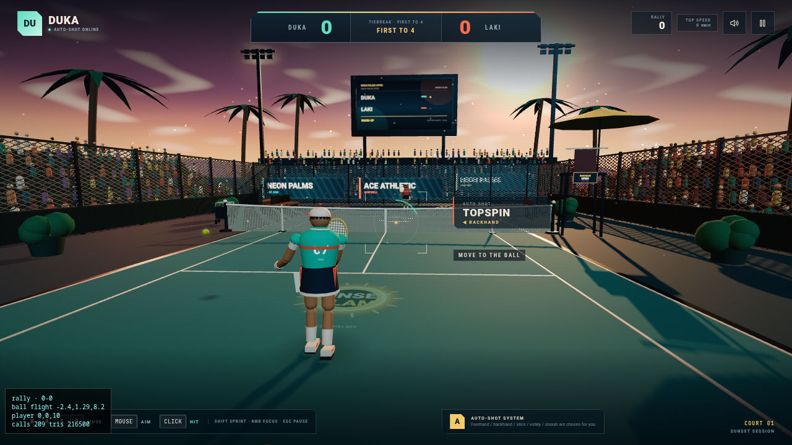
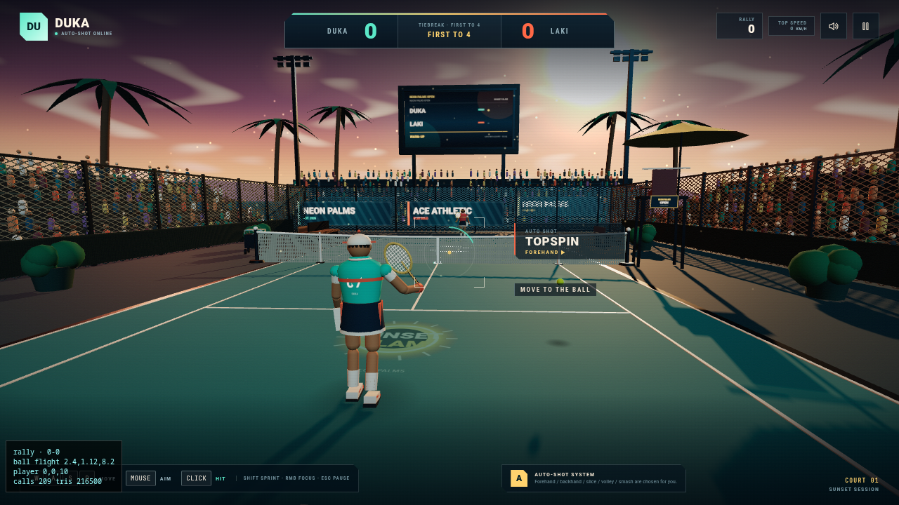
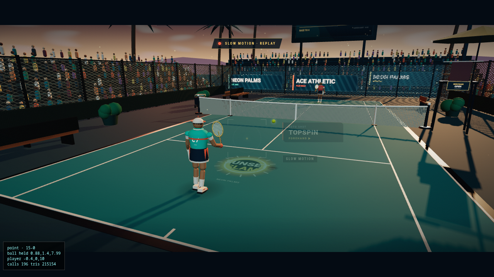

# SUNSET SLAM

Third-person arcade tennis for the browser, in the spirit of a Fortnite
over-the-shoulder camera: you move and aim, and an **auto-shot system** picks
the stroke — topspin, drive, slice, volley, smash, lob or drop — from the
situation. First to 4 points (2 clear) wins the tiebreak.

You are **DUKA** (teal, near court). Opponents: **LAKI** — a friend over your
home network, or the same rival driven by the CPU when he's not around.


## Run it — the one-click way

Double-click the **SUNSET SLAM (Host Match)** icon (in your application list
and on the desktop). It starts the match server, opens a host page with the
exact links to send Laki (copy buttons included), and stays running in the
background. The page also has a STOP SERVER button (only usable from this PC).

Command-line equivalent: `./sunset-slam-host.sh` (add `SUNSET_SLAM_NO_OPEN=1`
to skip opening the browser).

Manual steps, if you ever need them:

```bash
npm install
npm run build          # production bundle in dist/
node server.mjs        # game + multiplayer on http://<LAN-IP>:4173
npm run dev            # UI development only (no WebSocket backend)
```

`server.mjs` is a dependency-free Node server that serves `dist/` **and**
relays LAN multiplayer over WebSocket. It binds all interfaces, so other
devices on the home network reach the game at
**http://172.16.10.122:4173** (wired; `http://172.16.10.195:4173` over
Wi-Fi). If a device can't connect, check the host firewall allows TCP 4173.

## Playing against Laki

1. On your PC: title screen → **HOST LAN MATCH**. A 4-letter match code
   appears, plus a *COPY LINK* button that copies
   `http://<your-ip>:4173/?join=1&code=CODE`.
2. On his device (phone or PC on the same network): open that link — or open
   the game and press **JOIN LAKI** (auto-finds your open match), or type the
   code.
3. When he joins, both screens show **DUKA VS LAKI** and the match starts.
   You keep the near court; Laki plays the far side with his own camera,
   aiming and hitting exactly like you do.
4. Either side can host — the other joins. Whoever is missing, the other can
   play **VS COMPUTER** against the CPU-driven LAKI instead.

The host's browser runs the authoritative match simulation; the guest streams
inputs (~30 Hz) and receives state snapshots (~20 Hz), so a dropped connection
simply ends the match gracefully back at the menu.
### Playing across the world (Vietnam ↔ Serbia)

The match server runs on Duka's PC in Vietnam; Laki connects from Serbia over
the internet. Pick one of these routes:

1. **Tailscale (recommended — free, no router changes).** Duka's machine is
   already on a tailnet (`100.103.41.116`). In the Tailscale admin console,
   invite Laki's device to the tailnet, then Laki opens
   `http://100.103.41.116:4173`. Traffic goes device-to-device (or via a
   relay when NATs are strict) and is encrypted end-to-end.
2. **Router port forwarding.** Forward TCP 4173 on the Vietnam router to this
   PC, then Laki opens `http://<public-ip>:4173` (find it with
   `curl ifconfig.me`). Note: some Vietnamese ISPs use CGNAT — if the public
   IP starts with `100.x` or `10.x`, forwarding will not work; use option 1
   or 3.
3. **Cloudflare quick tunnel (free, no account).** Install `cloudflared`, run
   `cloudflared tunnel --url http://localhost:4173`, and share the generated
   `https://…trycloudflare.com` URL. The URL changes each run.

Whichever route you use, the game itself is identical: the JOIN button and
match codes work over any of them. Expect roughly 150–250 ms round trip
between Vietnam and Serbia — prediction keeps movement crisp, and hit
validation uses the state Laki actually saw.


## Controls

On a phone: the **RUN** joystick (bottom-left) moves the athlete, dragging the
right side of the screen aims the camera, and the **HIT** button plays the
auto-chosen shot. Controls sit inside the visible viewport (dynamic viewport
height + safe-area insets), so phone browser toolbars never clip them.

| Input | Action |
| --- | --- |
| `W A S D` / left stick | Move (camera-relative) |
| Mouse / drag right side | Aim the reticle anywhere in the rival court |
| `Click` / `Space` / HIT button | Serve, or hit with the auto-selected shot |
| `Shift` | Sprint |
| Right mouse button | Focus (zoom, slower movement) |
| `Esc` | Pause (also resumes) |
| `M` | Mute |

## Forehand or backhand — you can see it coming

The auto-shot system also picks the **hand**: a ball arriving on your right is
a forehand, on your left a backhand. The game telegraphs it before contact so
you can read the ball:

- the athlete **coils to the striking side** in the ready stance (racket out
  to the right for forehand, racket across the body for a two-handed backhand)
- the HUD chip shows the side: **FOREHAND ▶** / **◀ BACKHAND**
- a small **catch assist** lunges you the last half metre into balls that are
  just out of reach, so late reactions still connect




## HUD

Everything lives in one compact cluster in the lower-left corner — score,
shot type and hand, rally, speed, prompts and the point result — so the court
stays clear and the view can breathe. The aiming reticle stays at screen
centre where you're aiming.

## Controls

```
W A S D          move
```

## The auto-shot system

You never pick a stroke. The system reads ball height, your court position and
your aim, then announces the shot on the HUD chip and colors the reticle:

- **High ball near the baseline** → SMASH
- **Inside the service box** → VOLLEY (or DROP if you aim short)
- **Low ball** → SLICE
- **Ball behind you, low** → LOB
- **High, deep, neutral** → TOPSPIN or DRIVE
- **Start of the point** → auto SERVE

Timing is the skill: the contact rating (PERFECT / GOOD / LATE / STRETCH)
scales power and precision. Clicks are **buffered**: pressing HIT as the ball
bounces (the natural rhythm) arms the swing and it fires automatically the
instant the ball reaches your racket, so a well-timed-but-early click is never
wasted. Laki the rival errs under stretch and long rallies,
so points end through winners *and* mistakes.

## Point replay — slow motion

Every rally is recorded in a rolling buffer. When a point ends, the game cuts
to a **slow-motion replay** of the final shot — letterboxed, broadcast camera,
slow-motion badge — then reveals the point graphic and moves to the next serve.
Plays on both sides in LAN/internet matches too.



## Tech

- Three.js `0.160` + Vite 5, no physics engine — deterministic custom
  projectile integration (fixed 120 Hz substeps) with net-cord and bounce
  resolution, tuned restitution/friction per shot.
- Entirely procedural art: shader sky, canvas-painted court/ball/net textures,
  merged-buffer stadium (crowd, stands, palms, fencing), lathe/capsule
  characters with keyframed swing poses, pooled particle/ring VFX.
- Procedural Web Audio: pink-noise crowd, reverb tail, four-chord synth pad,
  and event-driven SFX (racket pop, bounce, net, applause).
- Seeded RNG throughout; `window.__THREE_GAME_TEST_HOOKS__`
  (`seed`, `setState`, `getState`, `setPausedForScreenshot`, `setReducedMotion`)
  drive the QA bots and the canvas-inspector evidence passes in
  [`artifacts/final-evidence.md`](artifacts/final-evidence.md).

## Project layout

```
index.html            UI shell: title, HUD, modals, touch controls
src/main.js           Game class: match flow, camera, input, scoring, test hooks
src/config.js         Court metrics, shot table, tuning constants
src/court.js          Procedural stadium, lighting, sky, crowd, scoreboard
src/characters.js     Rigged player/rival + keyframed swing animation
src/ball.js           Ball physics, trajectory solver, trail, glow
src/effects.js        Shake, FOV punch, particles, rings, hitstop helpers
src/audio.js          Web Audio engine (crowd, music, SFX)
src/ui.js             DOM HUD bindings and state wiring
src/textures.js       Canvas texture factory (court, ball, net, jersey, screens)
scripts/              Capture, bot-playtest and inspector drivers
artifacts/            Evidence passes (screenshots, reports, motion video)
```
